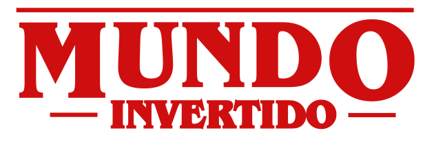

<p align="center">
  
</p>

<p align="center">
  <b>Mundo Invertido | Semana Front-end</b><br>
  Uma jornada para quem não tem medo do desconhecido.
</p>

---

O caminho para o Mundo Invertido é incerto, repleto de obstáculos e perigos. Porém, a recompensa é grande: salvar Hawkings e o mundo todo das garras de Vecna. Você está preparado(a)?

Este projeto nasceu na **Semana Front-end da DIO** e é uma página inspirada em Stranger Things, onde um botão inverte o site entre o **Mundo Normal** e o **Mundo Invertido**.

## 🙌 Créditos e agradecimentos

Este projeto **não seria possível sem os criadores originais**. Todo o conceito, o design, a estrutura e as aulas da Semana Front-end foram idealizados por eles, que ensinaram de forma clara, divertida e generosa como transformar HTML, CSS e JavaScript em algo memorável. Meu muito obrigado a:

<p>
  
  <b>&nbsp;&nbsp;&nbsp;Diogo Medeiros Mainardes</b><br>
  &nbsp;&nbsp;&nbsp;<a href="http://instagram.com/diogomainardes.dev">Instagram</a> | <a href="https://github.com/diogomainardes">GitHub</a> | <a href="https://www.linkedin.com/in/diogomainardes/">LinkedIn</a> | <a href="https://www.twitch.tv/dimmbr">Twitch</a>
</p>
<br/><br/>
<p>
  
  <b>&nbsp;&nbsp;&nbsp;Michele Queiroz Ambrosio</b><br>
  &nbsp;&nbsp;&nbsp;<a href="http://instagram.com/programi_">Instagram</a> | <a href="https://github.com/micheleambrosio">GitHub</a> | <a href="https://www.linkedin.com/in/michele-ambrosio-a4899661/">LinkedIn</a> | <a href="https://www.twitch.tv/michele_ambrosio">Twitch</a>
</p>
<br/><br/>
<p>
  
  <b>&nbsp;&nbsp;&nbsp;Renan Johannsen de Paula</b><br>
  &nbsp;&nbsp;&nbsp;<a href="https://github.com/RenanJPaula">GitHub</a> | <a href="https://www.linkedin.com/in/renanjpaula/">LinkedIn</a>
</p>
<br/><br/>

Também agradeço à **[Digital Innovation One (DIO)](https://www.dio.me/)** por abrir esse tipo de oportunidade de aprendizado prática e gratuita.

- 🔗 Projeto original: [micheleambrosio/semana-frontend-mundo-invertido](https://github.com/micheleambrosio/semana-frontend-mundo-invertido)
- 🌐 Demo original: [micheleambrosio.github.io/semana-frontend-mundo-invertido](https://micheleambrosio.github.io/semana-frontend-mundo-invertido/)
- 🎨 Design: [Figma do projeto](https://www.figma.com/file/I3Q42CcVUziRN3iMfTrbfb/Stranger-Things?node-id=0%3A1)

As imagens, os áudios e o layout base vêm do material oficial do projeto. Stranger Things é marca de seus respectivos proprietários, e este projeto tem fins exclusivamente educacionais.

## ▶️ Semana Front-end

- [Live Dia 01](https://www.youtube.com/watch?v=FZgIQUDn8zo)
- [Live Dia 02](https://www.youtube.com/watch?v=WHbhgxJLbN4)

## ✨ O que eu adicionei nesta versão

Mantive a base e a identidade do projeto original e criei por cima:

- **Troca de mundos animada:** a tela pisca e treme, as imagens se invertem, o texto pisca e aparecem esporos flutuando. Também funciona com a tecla `I`.
- **Música com transição** (fade) entre os dois mundos e botão para ligar ou desligar o som.
- **Preferências salvas:** o tema e o som ficam gravados no navegador.
- **Dado D20 no formulário** para sortear o level, com mensagens especiais para 20 e para 1.
- **Formulário com validação** e lista "A party de Hawkins", com as últimas inscrições salvas no navegador (`localStorage`).
- **Lâmpadas piscando**, animações ao rolar a página e layout responsivo.
- **Correções de HTML e acessibilidade** (labels, atributos `role` e marcação).

## 💻 Tecnologias

- HTML
- CSS
- JavaScript

## 💬 Assuntos abordados

- HTML
  - Estruturação da página
  - Semântica
  - Acessibilidade
  - Web Scraping
  - SEO
- CSS
  - Posicionamentos
  - Pseudo-elementos
  - Pseudo-classes
  - Flexbox
  - Animações
- JavaScript
  - Introdução ao JavaScript
  - Manipulação do DOM
  - Introdução ao Firebase
  - Integração com o Firebase

## 🎨 Variáveis do Tema CSS

```css
/*** VARIABLES & THEMES ***/

:root {
  --primary-color: #cf0f0f;
  --primary-color-contrast: #ffffff;
  --field-background-color: #000;
}

.light-theme {
  --page-background: linear-gradient(180deg, #ffffff 0%, #ffffff 65%, rgba(255, 255, 255, 0.75) 100%);
  --header-background-color: #e3e3e3;
  --highlight-color: #000000;
  --featured-font-family: "Archivo", sans-serif;
  --character-top-image-src: url("../images/characters/kids-on-the-bike.svg");
  --character-top-image-color: #ffffff;
  --character-bottom-image-src: url("../images/characters/inverted-world-monster.svg");
  --character-bottom-image-color: #e5e5e5;
  --background-lamp-image: url("../images/backgrounds/lamps.png");
  --footer-background-color: #b5bbbf;
}

.dark-theme {
  --page-background: linear-gradient(180deg, #050000 0%, #130404 65%, rgba(19, 1, 1, 0.75) 100%);
  --header-background-color: #220f0f;
  --highlight-color: #ffffff;
  --featured-font-family: "Rubik Glitch", sans-serif;
  --character-bottom-image-src: url("../images/characters/kids-on-the-bike.svg");
  --character-bottom-image-color: rgba(255, 255, 255, 0.1);
  --character-top-image-src: url("../images/characters/inverted-world-monster.svg");
  --character-top-image-color: #000;
  --background-lamp-image: url("../images/backgrounds/lamps-inverted.png");
  --footer-background-color: #000;
}
```

## 🚀 Como executar

1. Baixe ou clone o repositório.
2. Abra o arquivo `index.html` no navegador. Não precisa instalar nada.

## 📁 Estrutura

```
index.html
assets/
├── css/styles.css   # temas, layout e animações
├── js/main.js       # tema, música, D20 e inscrições
├── images/          # personagens, fundos, banner e conteúdo
└── musics/          # trilhas do mundo normal e do invertido
```

## 👨‍💻 Sobre mim

Olá! Eu sou o **Vinícius Cruz dos Santos** 👋


- 💻 **Conhecimentos:** HTML, CSS, JavaScript, Python, Java, C++ e MySQL
- 🎨 **Design:** Blender, Photoshop e Lightroom
- 📊 **Ferramentas:** pacote Microsoft (PowerPoint, Word e Excel)
- 🌎 **Idiomas:** inglês avançado e espanhol básico

[](https://github.com/Viniciuscruzdossantos)

## 🔗 Links auxiliares

- [W3C - World Wide Web Consortium](http://w3c.org)
- [WAI - Web Accessibility Initiative](https://www.w3.org/WAI/)
- [WCAG 2](https://www.w3.org/WAI/WCAG21/quickref/)
- [Figma](https://www.figma.com/file/I3Q42CcVUziRN3iMfTrbfb/Stranger-Things?node-id=0%3A1)
- [Demo](https://micheleambrosio.github.io/semana-frontend-mundo-invertido/)

---

<p align="center">Feito com 💙 muito aprendizado na Semana Front-end da DIO.</p
